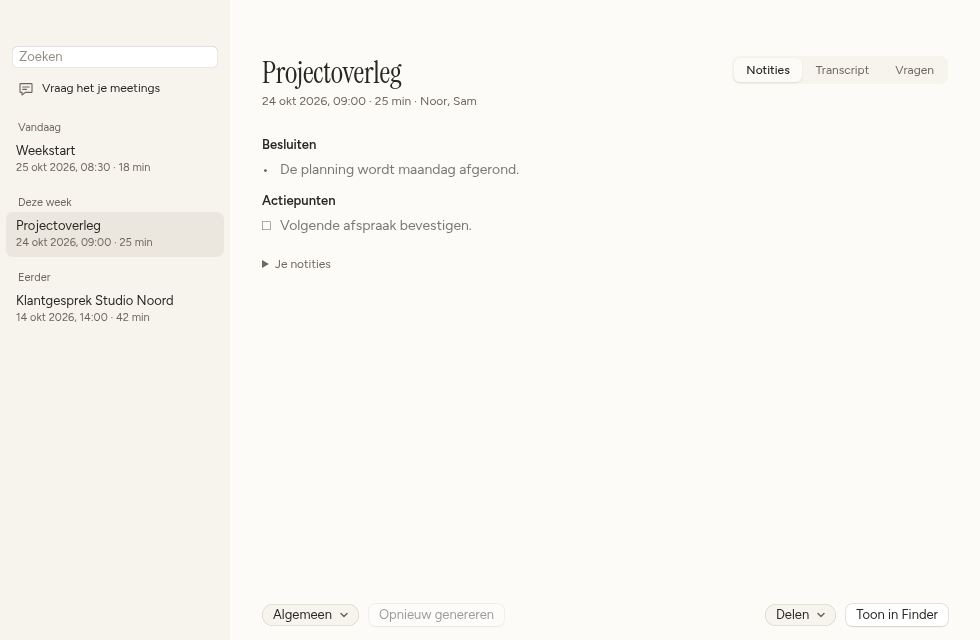

<p align="center">
  <picture>
    <source media="(prefers-color-scheme: dark)" srcset="assets/readme/wordmark-dark.svg">
    
  </picture>
</p>

<h1 align="center">Say it. Full stop.</h1>

<p align="center">
  Dictation where you type. Meeting notes kept on your computer.
</p>

<p align="center">
  <a href="https://github.com/pennel-app/pennel/releases/latest"><strong>Download Pennel</strong></a>
  &nbsp;·&nbsp;
  <a href="#get-started">Get started</a>
  &nbsp;·&nbsp;
  <a href="https://github.com/orgs/pennel-app/projects/1">Roadmap</a>
  &nbsp;·&nbsp;
  <a href="CONTRIBUTING.md">Contribute</a>
</p>

<p align="center">macOS · Windows · Linux &nbsp; / &nbsp; Open source · Apache-2.0</p>

<picture>
  <source media="(prefers-color-scheme: dark)" srcset="assets/readme/meeting-dark.png">
  
</picture>

<p align="center"><sub>Example meeting content. Pennel’s interface is currently in Dutch.</sub></p>

Write an email by speaking. Turn a conversation into notes you can come back to. Pennel brings dictation and meetings together, with local models or a provider you choose.

## Install

Choose your installer from the [latest release](https://github.com/pennel-app/pennel/releases/latest).

| Platform | Requirements | Download |
| --- | --- | --- |
| macOS | Apple Silicon · macOS 14.4 or later | [`.dmg`](https://github.com/pennel-app/pennel/releases/latest) |
| Windows | Windows 11 · x64 | [`.exe` or `.msi`](https://github.com/pennel-app/pennel/releases/latest) |
| Linux | x86-64 · WebKitGTK 4.1 | [`.deb` or `.AppImage`](https://github.com/pennel-app/pennel/releases/latest) |

On a Mac, you can also install with Homebrew:

```sh
brew install --cask pennel-app/pennel/pennel
```

Mac releases use Pennel’s own signing certificate and are not yet Apple-notarized; the Homebrew cask handles download quarantine. Windows installers are unsigned, so SmartScreen may ask for confirmation. Linux users should check the [runtime dependencies](docs/linux-packaging.md#runtime-prerequisites), including when using an AppImage.

## Get started

1. **Choose your speech model.** The setup wizard starts with local recognition. Download a model or configure your preferred provider.
2. **Grant access.** Follow the prompts for your microphone and the permissions needed for shortcuts, pasting and meeting audio.
3. **Say something.** Hold <kbd>fn</kbd> on an Apple keyboard, or <kbd>Right Ctrl</kbd> on Windows and Linux X11. Speak, then release to place the text where you were typing.

On Mac, set **System Settings → Keyboard → Press 🌐 key to → Do Nothing** when using `fn`. External keyboards can use a [different shortcut](docs/desktop.md#dictation-destinations-and-live-text).

On **Linux Wayland**, [set a desktop shortcut](docs/desktop.md#linux-x11-and-wayland) to `pennel --toggle-dictation`. Press once to start, again to finish, then paste with <kbd>Ctrl</kbd> + <kbd>V</kbd>.

## From speech to finished text

Hold to talk, or double-tap for hands-free dictation. Use your chosen text model to clean up what you said, apply a writing style, or give an instruction about selected text where your platform supports it.

Prefer to work in one place? Open the dictation pad to speak, edit and copy your text. Previous dictations are available in History.

## Meetings worth coming back to

Record your microphone and computer audio, then review the transcript alongside your own notes. Generate a summary, keep action items, name speakers and ask questions with links back to the source passage.

Search past meetings and export the parts you need. Recordings and Markdown files live in a folder you choose, so your notes remain useful outside Pennel.

Audio capture, automatic meeting detection and echo handling depend on your operating system and devices. See [platform support](docs/desktop.md#platform-behavior) for the details.

## Your models. Your files.

Use downloadable speech models, Apple’s built-in models on compatible Macs, or your own provider. OpenAI-compatible services, Ollama and LM Studio are supported. Choose speech recognition and text processing separately.

- **No telemetry.** No Pennel account is needed to use local models or your own provider.
- **Keys stay in your system’s credential store.** Keychain on Mac, Credential Manager on Windows and Secret Service on Linux.
- **You choose what leaves your computer.** A remote provider receives the audio or text needed for the task you select. Meetings and recordings are stored locally.

Apple dictation requires macOS 26 or later. Apple Intelligence also requires an eligible Mac with Apple Intelligence enabled. Other local models work on the supported systems listed above.

## Follow along

Pennel is under active development. Follow the [Pennel roadmap](https://github.com/orgs/pennel-app/projects/1) for desktop, iPhone and Cloud work, or read the [desktop acceptance tasks](docs/desktop-roadmap.md) for validation and release criteria. An organisation owner still needs to [make the board public](https://github.com/pennel-app/pennel/issues/25).

[Report a bug](https://github.com/pennel-app/pennel/issues/new) or read the [contributing guide](CONTRIBUTING.md).

For builds, troubleshooting and platform details, start with the [desktop development guide](docs/desktop.md).

## License

Pennel is licensed under the [Apache License 2.0](LICENSE). “Pennel” and the Pennel logo are trademarks of the project owner; forks must use a different name and logo.
