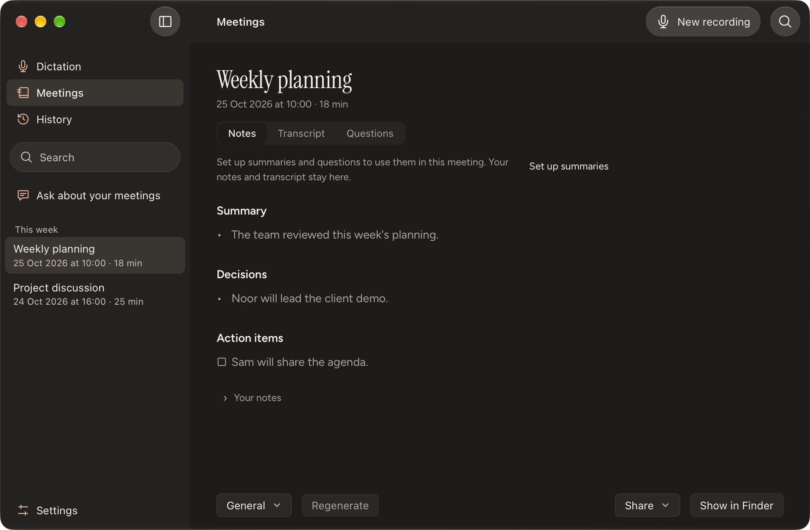

# macOS native materials and interaction audit

This follow-up to [#65](https://github.com/pennel-app/pennel/issues/65) retains Tauri and the TypeScript/Vite frontend. It is based on desktop polish PR #66. The previous Chromium fixtures and the running Preview window showed opaque navigation surfaces, fixed titlebar offsets, incomplete inactive-window states and no Reduce Transparency or Increase Contrast integration.

## Implementation ownership

| Layer | Responsibility |
| --- | --- |
| Swift macOS integration | Material host, empty unified toolbar for system geometry, public AppKit availability guards, actual window appearance, live accessibility/focus notifications, owner-attached application picker |
| Rust/Tauri | Host lifecycle and typed environment events, native menu commands and availability, owner-attached folder picker, isolated capture profile |
| Tauri macOS configuration | Transparent webview, native decorated overlay titlebar and hidden visual title; macOS 14.4 remains the minimum |
| Frontend and shared tokens | Toolbar, adjustable/collapsible sidebar, system-font chrome, opaque reading content, accessible states and keyboard navigation |

The host assigns the retained webview presentation to `NSGlassEffectView.contentView`. The pinned Tauri 2.12.5/window-vibrancy 0.8.1 effect implementation does not establish that relationship. Apple's [AppKit adoption guidance](https://developer.apple.com/videos/play/wwdc2025/310/) recommends embedding content inside the effect. No new runtime dependency is required.

Regular Liquid Glass is available on macOS 26+. Older supported versions use native sidebar/popover visual effects. Transparency and increased-contrast preferences select opaque chrome. Controls remain HTML: one host provides one native material shape, without per-button native refraction or merging. The Ink dictation pill keeps its existing high-contrast, nonactivating presentation.

The capture identity `dev.pennel.Pennel.capture.preview` uses a separate fixture data root and credential service. It never changes `HOME` or shares the installed Preview's single-instance identity. Only preview capture mode accepts the fixture-root override.

## Verification

Local verification on macOS 27.0.1 / Xcode 27:

- `make core && make test && make app`: passed, including 622 Rust core tests (five existing ignored) and 53 legacy Swift/smoke tests.
- Desktop frontend build and 212 tests; desktop backend 217 tests; Rust formatting/Clippy; 112 Swift platform tests; 50 packaging/capture tests; 12 theme-generator checks: passed.
- Owned EN/NL light/dark fixtures cover native environment changes, preserved drafts/focus, toolbar/sidebar keyboard behavior, History, menus and picker cancellation. Revised native captures show actual Liquid Glass, matched frontend/native environment snapshots, a 52 point titlebar and 79 point native-control extent after the padding refinement.
- Actual application-menu shortcuts, sidebar/Find, native History context menus, owner-attached application-picker sheets/cancellation, fullscreen and the minimum 760×520 window were exercised. No microphone capture, provider calls or key changes were needed.
- Actual Reduce Transparency, Increase Contrast and Reduce Motion preferences changed the running app's native and frontend states together. Original preferences and the original System Settings page were restored.
- The existing mobile token-parity test caught the two additional color roles missing from native iPhone metadata. Its unused color map now matches the canonical palette; 64 MobileKit tests, 46 mobile UI tests and the mobile typecheck pass.

Native captures use a separate app identity and only owned window IDs. Browser fixtures establish frontend layout and event handling; they do not establish native material rendering. The capture bundle is development/ad-hoc signed. Older macOS 26/14.4/15 visual acceptance, Windows/Linux execution, human VoiceOver/enlarged-text acceptance, hosted CI and merge remain open. Capture-control launches can affect focus, so active/inactive observations require independent focus transitions rather than merely naming a snapshot inactive.

### Reviewed desktop candidate

Desktop code revision: `ad4a4b1b388e2e6aa40d14f1a3f3a36860c98367`. The development capture executable's SHA-256 is `89275b1916dffa4e4c987157f5b8d63c89b362353d4956a30ee1a42756727b9f`; its ad-hoc bundle passed `codesign --verify --deep --strict`. Later evidence-only commits do not change desktop code.

The [machine-readable receipt](evidence/macos-liquid-glass-2026-10-29/receipt.json) records four current native EN/NL light/dark captures and separates historical checks from the current search-spacing candidate. The retained padding candidate also exercised circular sidebar/search activation, fullscreen, the maximum sidebar at minimum window size, and real transparency/contrast preferences. Native and frontend states matched; the controls stayed visible with opaque fallbacks. Original settings and the original System Settings page were restored.

The requested minimum fixture size is 760×520. Native toolbar/layout adjustment can raise the measured viewport height; receipts retain the actual dimensions instead of assuming a fixed OS result. Footer actions remain contained and reachable.

## Visual research and revision

The first native-window captures proved that the material was system-rendered, but the user rejected their appearance. The extra command row, large text buttons and broad gray background did not match a native writing app. Those captures are a superseded prototype, not visual acceptance.

The revised reference is Apple's own Notes and Finder interface, inspected in light and dark screenshots from the [toolbar guidelines](https://developer.apple.com/design/human-interface-guidelines/toolbars), [Notes guide](https://support.apple.com/guide/notes/welcome/mac) and [Finder guide](https://support.apple.com/guide/mac-help/mchle9f0a1b2/mac). These references use compact symbol actions in the window's top band, quieter surfaces, clear source-list hierarchy and content-aligned commands. Pennel keeps its branded reading typography while applying those structural conventions.

| First pass | Revised treatment |
| --- | --- |
| A titlebar followed by another command row | One compact frontend command row in the measured native titlebar band |
| Large Hide sidebar and Search text buttons | Familiar sidebar/search symbols with accessible labels and tooltips |
| Heavy primary recording block on the leading side | A quiet trailing recording action with the existing behavior |
| Gray material with low-contrast metadata | Semantic translucent navigation backing and a separately checked secondary text role |
| Uniformly muted source-list icons | Accent navigation icons in the active Mac window, neutral inactive state |

[Apple's macOS 27 design update](https://developer.apple.com/videos/play/wwdc2026/102/) uses edge-to-edge sidebars, more uniform toolbars and colored sidebar icons. This is the current host's reference; macOS 26 and earlier retain the supported material fallbacks. A native host remains necessary for real Liquid Glass, but material availability alone is not proof of good visual composition.

Navigation text contrast is checked over black and white backdrop extremes. Both primary and secondary labels must remain at least 4.5:1 after compositing the semantic backing. The toolbar continues using frontend controls; no independent native glass shape or interactivity is claimed for individual HTML buttons.

### Padding and button surfaces

The later Notes reference clarified that a compressed 32 point row and bare icon glyphs were still too dense. The refinement uses the canonical 52 point toolbar, 36 point circular sidebar/search controls, a 36 point recording capsule, 18 point glyphs and 12 point group gaps. Source navigation uses 13 point labels in 32 point rows; ordinary controls and fields have at least 28 point height and wider insets. Content headings retain 32 point horizontal alignment. Footer controls wrap at the minimum width instead of becoming clipped.

An empty public `NSToolbar` with `.unified` style provides native titlebar geometry and traffic-light placement without moving any action into native UI. AppKit reports a 52 point band with a 79 point control exclusion on the current Mac. The retained WKWebView still receives header hits. The material host owns and restores this toolbar, preserving later replacements by another owner; prompts, the pill and other windows are unaffected.

Button shapes use translucent semantic fills, a hairline edge and a restrained highlight above the existing native material. Their appearance is frontend styling; each button does not acquire an independent native refraction effect. Foreground contrast is checked through both the control fill and navigation backing over black and white extremes. The supplied reference image and its contents are not part of the repository or review artifacts.

### Search-field spacing — 30 October 2026

The sidebar search field has a shared 36 point minimum height, 12 point leading icon inset and 8 point gap before text. A centered canonical SVG replaces the manually positioned pseudo-elements. The input and its existing search/focus handlers remain the same node. Frontend build/tests, EN/NL light/dark and minimum-width fixtures, required core/native checks and the packaged app passed. Actual typing/filtering and focus were checked with the sidebar at its 200 point minimum.
