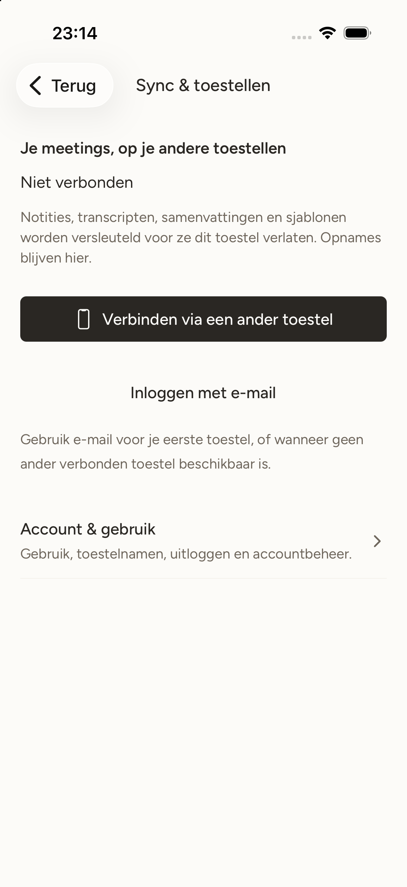
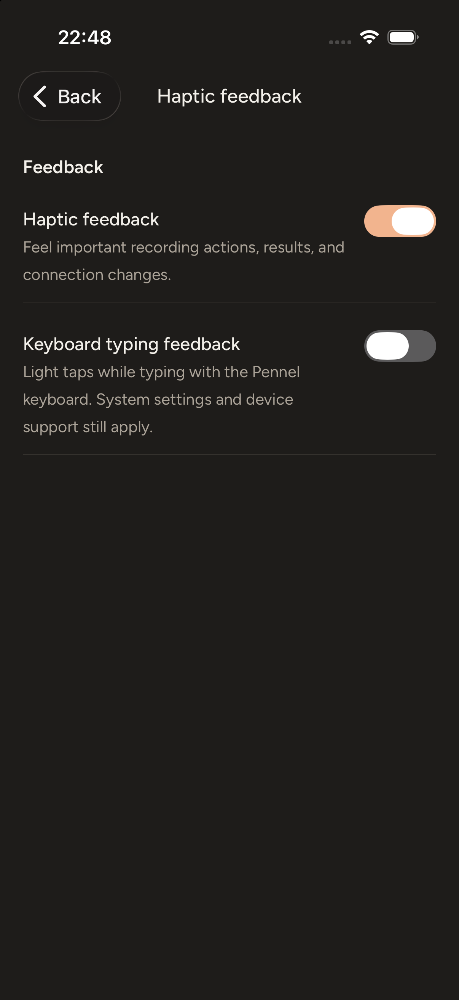

# Expo mobile implementation

Status: Expo is the mobile application UI. The legacy SwiftUI iPhone shell is retired under [cleanup #75](https://github.com/pennel-app/pennel/issues/75); its reusable native services and regression tests now belong to the mobile workspace. Signed-device, upgrade, keyboard, Cloud deployment and store acceptance remain open.

Tracking: [Expo migration #42](https://github.com/pennel-app/pennel/issues/42), [Cloud speaker recognition #38](https://github.com/pennel-app/pennel/issues/38), [keyboard experience #39](https://github.com/pennel-app/pennel/issues/39), [device acceptance #18](https://github.com/pennel-app/pennel/issues/18), and [signing/store readiness #20](https://github.com/pennel-app/pennel/issues/20).

Current cleanup verification: [legacy shell retirement — 30 October 2026](#legacy-shell-retirement--30-october-2026).

## Confirmed decisions

- Expo SDK 58, compatible React Native, TypeScript, Expo Router and development builds. iPhone first; Android follows iPhone acceptance.
- Continuous Native Generation: native projects are generated and ignored. All owned native source, artifacts and config-plugin definitions live outside generated projects.
- Expo Widgets owns widget/Live Activity generation and presentation wherever verified native integration supports the required actions. Pennel's addon owns remaining native source membership and system actions.
- One native-owned Rust engine. Recording, keyboard handoff, processing and synchronization do not depend on JavaScript remaining active.
- iOS 26 minimum. No bundled local speech or speaker models. Private Apple providers and account-free ordinary use remain supported; Cloud is optional.
- English and Dutch, system-first supported language with English fallback, independent of speech language and user content. Use canonical brand assets. Follow the shared [language policy](language-policy.md): English canonical diagnostics, localized owned failure messages, and literal user content. Older string-only keyboard/session failures remain readable alongside optional failure codes.

- iOS uses Expo Router's native system tabs with Liquid Glass on iOS 26+, localized accessibility labels and system appearance. Keep native materials and system tab behavior.
- Use [Expo Device Hub](mobile-device-hub.md) for simulator interaction, accessibility inspection and app-owned screenshots. It is a pinned development dependency, separate from the application runtime.
- Desktop remains Tauri. The user-approved retirement of both SwiftUI shells replaces the old retain-until-acceptance requirement; physical-device and signed-upgrade acceptance still require their own evidence.

## Native ownership

The mobile workspace owns routes, a local `PennelMobile` Expo module and CNG plugins. `apps/mobile/native/ios/` is the canonical home of reusable native code: `Services/`, the `MobileKit/` Swift package, `Keyboard/` (including its guarded feasibility probe), `KeyboardTests/`, native `Widgets/` helpers and hosted `Tests/`. Generated mobile projects contain target membership, not owned source.

| Artifact | Owner |
| --- | --- |
| Main application/navigation | Expo/Router; native boot runs before JavaScript |
| Rust XCFramework and UniFFI Swift bindings | Explicit native preparation writes matched `PennelCoreFFI.xcframework`, `PennelCore/pennel_core.swift` and `manifest.json` directly under ignored `apps/mobile/artifacts/ios/` |
| Native app services and tests | `native/ios/Services/` compiles into `PennelMobile`; `native/ios/Tests/` exercises services in the generated hosted runtime target |
| MobileKit | Local static CocoaPod over `native/ios/MobileKit/Sources/`, including ActivityKit attributes; retain the package's Swift tests |
| Keyboard target/resources/embedding/tests | Pennel config plugin; helpers only, no Rust/Expo runtime |
| Widget target | Expo Widgets plugin, followed by Pennel's source/intent/Control Center addon |
| Permissions, fonts, background tasks and entitlements | App configuration and Pennel plugin |

The widget extension may contain Expo Widgets' isolated runtime and lightweight native helpers; it does not own a product engine, provider credentials or Cloud session. The Expo generator recreates its target directory, so custom sources remain elsewhere and target membership must be recreated idempotently. Native intent declarations compile directly into the app and widget targets; only the app defines `PENNEL_APP`.

Production preserves `app.pennel.ios`, its `.keyboard`/`.widgets` extension identifiers, `group.app.pennel`, `pennel` URL scheme, Keychain service/accessibility and existing container-relative data paths. Preview uses independent bundle/group/Keychain/handoff identities. Core locks and databases remain in the app container; shared groups contain only the bounded extension handoff and widget state. Re-resolve absolute sandbox paths on launch.

## Runtime contracts

`PennelMobile` exposes typed asynchronous commands and snapshots/events for initialization, capabilities, dictation/history, meetings/notes/transcripts, summaries/templates, search/chat/sources, playback/export, settings/providers, account/devices/recovery/conflicts, and speaker jobs. A monotonic revision supports reconnection after JavaScript reload. Unsupported capabilities remain visible with a reason.

PCM, upload bodies, embeddings, refresh tokens and vault keys stay native. Provider credentials are write-only from the UI; one-time recovery display remains transient. No private content is logged or persisted in JavaScript. Existing Rust auth, crypto, file formats and synchronization remain authoritative.

### Interface inventory

This inventory records the active Expo surfaces and native ownership. Historical SwiftUI source remains in Git; simulator and signed-device results remain separate.

| Surface | Expo implementation and native ownership |
| --- | --- |
| Meetings | Local list/search, recording, notes, transcript/playback, templates/summaries, speaker naming/recognition, questions, export, rename/delete and conflict files; native recording and Rust storage/processing |
| Dictation | Editable results, copy, history/retry, bounded keyboard sessions and recovery; native microphone and processing lifecycle |
| Ask | Cross-meeting questions and citations to the current source; Rust search/answers and guarded source navigation |
| Settings | Providers/credentials, per-task model selection and sample verification, dictionary, retention, appearance/language, keyboard preferences and account/sync/device/recovery controls |
| Onboarding | Native-backed first-run state, language/provider setup and explicit skip/resume; ordinary local use needs no account |
| Keyboard and system actions | Shared lightweight typing/handoff helpers, native App Intents, controls and ActivityKit; source and target membership regenerated by CNG |
| Platform restrictions | Desktop-only agents/local models and call/computer-audio capabilities remain visibly unavailable with reasons; Android native implementation awaits iPhone acceptance |

Stop dispatches to native capture before flushing notes. A failed save retains the draft and recording recovery, which is also reachable from Meetings. Rename waits for pending note saves; native retries validate the retained recording identity. Per-task model verification runs a fixed sample through the selected model, independently of catalog/account availability checks.

### Recognition jobs

Native-owned UniFFI jobs provide start, snapshot, cancel and restart/resume. A foreign audio reader returns owned blocks of at most 64,000 normalized 16 kHz mono frames using absolute offsets. New iPhone recordings use `audio/room.m4a` with an explicit physical room-microphone source. Playback and recognition resolve this path and legacy `anderen.m4a` through Rust; shared-room Others does not require an enrolled own voice. Private provenance and capture events follow the [recording format](recording-format.md), with capture duration frozen before transcription finishes and metadata writes included in save retry. Rust writes one PCM16 WAV spool at a time and retains the existing 600-second chunking/short-tail rules within the service ceiling. Native file transport supports cancellation and progress while Rust owns authentication, refresh, response validation, merging and attribution.

Stages: preparing, uploading, recognizing, response-unknown, interrupted, applying, completed, cancelled and failed. Server processing is indeterminate; decoded frames/upload bytes/confirmed chunks are separate measurements.

Private versioned manifests record UID, audio/transcript/name digests, model/algorithm/schema versions, ranges and confirmed results. Resume validates source identity and skips confirmed work. A dispatched timeout/disconnect becomes response-unknown: no automatic resend, and explicit retry explains possible duplicate quota use. User cancellation prevents late application and cleans temporary data; interrupted/recoverable failed work can resume or be discarded. Client cancellation does not guarantee server cancellation.

Recognition must work independently of LLM readiness. Naming a speaker does not silently enroll a voice. At apply time recheck stable UID and source revisions; use common core guards and recoverable multi-file application for transcript, names and voiceprints. Notes/audio are untouched. Recover interrupted saves before sync/export. Retain desktop's current recognition entry point as a compatibility wrapper over the same safe apply behavior.

## Keyboard and Live Activity feasibility

Issue #39 requires a complete keyboard-only interaction, including cold and expired sessions. Manual session start is an interim capability, not accepted completion. The user chose to decide release impact after feasibility evidence. Keep #39 open until the requested interaction works or the user explicitly accepts an alternative.

Use the existing active-session path as a control. Investigate documented system/App Intents invocation from a keyboard before relying on a cold-start route. Exclude responder-chain launching, private APIs, unrelated background modes and indefinite microphone activity. Record exact devices/iOS versions, permissions, Full Access, active/expired/suspended/cold/OS-terminated/force-quit states, lock/unlock, interruptions and focus changes.

Native typing work includes QWERTY/AZERTY, shift/caps, delete repeat, numbers/symbols, context return, spaces, keyboard switching and accessible dictation/recovery. Opt-in suggestions use documented `UILexicon` and Pennel dictionary data locally. Automatic insertion requires a matching live document proxy/lifetime/focus generation and an unconsumed dictation ID; uncertain or restarted contexts require explicit recovery. Typing/switching work without Full Access.

Prototype Expo Widgets-native Stop and lifecycle updates while JavaScript is unavailable. If that path is not verified, compile the existing native ActivityKit layouts through Pennel's CNG addon rather than depend on an old project. Following process termination capture has ceased; recovery reconciles interrupted state/stale activities without implying continued recording.

## Implementation and acceptance ledger

| Workstream | Current evidence |
| --- | --- |
| Expo/CNG foundation | Clean/repeated non-clean generation and normalized graph comparison passed; generated Release simulator builds passed. Device candidate verification is recorded below. |
| Native runtime and mobile UI | Native-owned services and four-tab Expo interface implemented; native Liquid Glass tabs and local data flows exercised through Device Hub. See [simulator evidence](mobile-simulator-qa.md). |
| Bounded speaker jobs/common commit path | Implemented with private checkpoints, bounded decoding, native cancellable transport, source guards and journal recovery; automated tests pass. Deployed recognition/quality evidence remains open. |
| Keyboard polish/context delivery/feasibility | Local typing/helpers and context guards implemented and tested; [cold-start evidence](mobile-keyboard-feasibility.md) remains incomplete and #39 stays open. |
| Widgets/Live Activities | Expo serialization prototypes and generated native ActivityKit fallback compile; [native control/device gates](mobile-widgets-feasibility.md) remain open. |
| Cloud service limits/deployment | Upload-admission fix prepared in [Cloud draft PR #16](https://github.com/pennel-app/pennel-cloud/pull/16); deployment and real-meeting acceptance remain prerequisites in [Cloud #8](https://github.com/pennel-app/pennel-cloud/issues/8). |
| Signed in-place upgrade/physical iPhone | Pending |
| Android native implementation | Gated on iPhone acceptance |

Required evidence: normalized target/source/resource/entitlement/Podfile comparisons across clean/repeated Prebuild; simulator/device archives; JavaScript reload/suspension; locked Stop and truthful termination recovery; a sixty-minute interrupted recording; recognition without enrollment or an LLM; Dutch/short-turn/long-recording quality; offline/auth/quota/service failures; unknown responses and low storage; cancel/restart/stale jobs and crash injection; rename/edit/delete/sync races; confirmed chunks never silently repeated; private job/audio files excluded from sync/export; multi-digit speaker compatibility; upgrade identity/credential/handoff preservation; keyboard worst-case peak memory against the 30 MB target, latency, CPU, battery, network, accessibility and microphone-active duration.

## Build and verification

From the repository root:

```sh
npm --prefix apps/mobile ci
make mobile-test
make mobile-prebuild
npm --prefix apps/mobile run build:ios
PENNEL_IOS_DESTINATION='generic/platform=iOS' npm --prefix apps/mobile run build:ios
make mobile-native-test IOS_DESTINATION='platform=iOS Simulator,id=<assigned-simulator-UUID>'
```

`mobile-prebuild` prepares matched lean Rust artifacts/bindings, compares clean/non-clean generation, restores a clean generated project, installs pods and checks actual dependency/source/linker ownership. Never place owned sources in `apps/mobile/ios` or `android`. SDK 58's repeated generation command explicitly uses `--no-clean`.

`build:ios` produces an unsigned ARM64 Release candidate in `apps/mobile/build/DerivedData/Build/Products`; it does not create a signed distribution archive. Native hosted tests use a separate Debug build directory and simulator ad-hoc signing. `mobile-native-test` runs the generated runtime, migrated native service suites and keyboard tests. `mobile-test` also runs the MobileKit Swift package tests. Run these builds sequentially: some Expo pod scripts switch shared precompiled SDK frameworks by configuration.

CI runs these same three configurations sequentially and publishes phase timing receipts. The [compiler-cache pilot](ci-performance.md) is opt-in through manual workflow inputs; normal pull-request and main checks keep it off. It caches only Xcode compiler outputs outside the generated project, requires an exact compatible seed for warm measurements, and retains all clean/repeated generation, pod ownership and native test gates. The documented build commands above use the same wrapper and forward the original Xcode arguments when the pilot is off.

For development, use `npm start` from `apps/mobile` and an installed development build. `npm run device:hub` also runs without Metro for Release-candidate QA; follow the [assigned-device workflow](mobile-device-hub.md). Default configuration uses preview identifiers and credentials. Production identity requires explicit `PENNEL_VARIANT=production`; its signed in-place upgrade has not been accepted.

## Historical verification receipts

The dated records below preserve the commands and paths used before shell retirement. Removed targets and legacy paths are historical, not current reproduction instructions; use [Build and verification](#build-and-verification) above. The [pre-retirement iOS sources](https://github.com/pennel-app/pennel/tree/e6f02b2cd178b541dcbfcdb46125336c762dbf07/apps/ios) and [Mac sources](https://github.com/pennel-app/pennel/tree/e6f02b2cd178b541dcbfcdb46125336c762dbf07/apps/macos) remain available at the recorded base revision. Counts and outcomes below apply only to their stated candidates.

Local checks on 27–28 October 2026 include mobile typechecking, 42 UI regressions, six plugin checks, seven widget probes, six real pod ownership checks, 61 Swift helper tests, and **21 hosted native runtime plus two keyboard tests**. The hosted suite now executes assertions: it exposed and verified repairs for early ActivityKit initialization during Objective-C framework loading and exact-EOF archive reads. Runtime startup remains in the app launch callback before scene/JavaScript creation.

The same integration passed the default and lean Rust suites, format/Clippy checks, desktop frontend/backend checks, native comparison-app tests, and Mac core/tests/app builds. Detailed final receipts and simulator limitations are tracked with the candidate below and in [simulator QA](mobile-simulator-qa.md). Local checks do not establish remote CI or release acceptance.

## Candidate receipts — 28 October 2026

These unsigned preview products were built from the generated workspace with Xcode 27.0, iOS SDK 27.0 and iOS 26.0 deployment target. Sizes are file totals for the complete app bundle, including its extensions; they are not App Store download sizes or memory measurements.

| Product | Bundle bytes | Executable SHA-256 |
| --- | --- | --- |
| ARM64 Release simulator | 69,742,619 | `d93567d23051e619d7516b2307573437994f40f7ada0a6ab924cc8942c108b22` |
| ARM64 Release iPhoneOS | 69,381,901 | `20bfd73a3c4188e4428b02002b116a5bce810198d968a3021016ea67b2a112e7` |

For the final citation repair, also identify the JavaScript and complete product: a native executable hash can remain unchanged after a JavaScript-only fix. The simulator `main.jsbundle` SHA-256 is `e7d4bd5e46d958e81ab9c98704036223075914a3f0013b438bb6c85513ee020f`, and its full file-manifest SHA-256 is `134c0136adbd4a2e4d35c64ae4ede2cbfd0265503bafd42aaffbab4f55f4b79a`. The iPhoneOS JavaScript/full-manifest hashes are `4bd277b8b16c6c321f2b997e24922ff285a6a69fdc478b046b31dc04d1ca7212` / `9285432220deea9e2979391d4e9f0cdb46f5d13236044a997980f30c26d99291`. The manifest hashes sorted relative UTF-8 filenames followed by NUL and each raw 32-byte file SHA-256 digest; file contents and paths both participate.

The simulator product was installed and exercised through Device Hub on iPhone 17 / iOS 26.5. The iPhoneOS product was compiled only. Neither is a signed distribution archive or a TestFlight build.

An actual unsigned iPhoneOS archive also passed with no generated-project repair:

```sh
xcodebuild archive -workspace apps/mobile/ios/Pennel.xcworkspace -scheme Pennel \
  -configuration Release -destination 'generic/platform=iOS' \
  -archivePath apps/mobile/build/Archives/Pennel-preview-1f79730.xcarchive \
  -derivedDataPath apps/mobile/build/DerivedData \
  ARCHS=arm64 ONLY_ACTIVE_ARCH=YES CODE_SIGNING_ALLOWED=NO
```

Use a fresh archive path for a new receipt. The archived app totals 47,621,576 bytes after archive stripping; executable SHA-256 `d57bcec01aed6182afee88fd2994ef2e20174c0c8d4b371fac93c21f204e1464`, JavaScript SHA-256 `c7c17e48c425957fc91ac017083f39c9408457eda104035b710c3e761e52a224`, and full file-manifest SHA-256 `2ece2c9a22ec3a021820d50ddfba6958ccf1ffbbb4236961c2e49af854997345`. This establishes archive buildability, with signing/export/device acceptance still open.

Matched Rust preparation records core commit `41a13dac1683a94386caba1da4f06a3122b06942`, core-source SHA-256 `227677c32f3da66af245858de249228e8f7690860a6013e3a51877a1bec20d54`, and Swift-binding SHA-256 `24eaea2e8a5eb396ae8d43fc59c5fd5b67336bd04b90e23f8e1ca977e7e9475b`. iOS and Mac UniFFI bindings were also compared byte for byte. The generated artifact manifest stays outside version control.

| Verification | Local result |
| --- | --- |
| Core default / lean | 595 passed, 5 existing ignored / 584 passed, 3 existing ignored; format and Clippy with warnings denied passed for both |
| Desktop | Frontend type/build and 185 tests; backend 197 tests; format/Clippy checks passed |
| Mac comparison | `make core`, `make test`, `make app`; 53 Swift tests and the default Rust suite passed |
| Native iPhone comparison | 63 hosted app tests plus 2 keyboard tests passed |
| Mobile UI/helpers | Typecheck, 42 UI tests, 61 Swift helper tests passed |
| Generation/ownership | Clean → non-clean → non-clean → clean normalized comparison, 6 plugin tests and 6 actual pod/linker/source checks passed |
| Widgets | 7 actual SDK serialization/render probes and TypeScript checks passed |
| Generated native runtime | 21 hosted runtime tests plus 2 keyboard tests passed on iPhone 17 / iOS 27.0, including synthetic AAC/M4A bounded seek/EOF, preview credentials, stale model/recovery commands and lifecycle cancellation |
| Metro | iOS Release bundling and standalone export passed |
| Device Hub | Native Liquid Glass navigation, light/dark, English/Dutch including live native accessibility labels, unassigned model persistence, controlled provider sample/summary/Ask and regular/overlapping transcript citations verified; see [QA details](mobile-simulator-qa.md) |

The earlier failing runs are retained locally under ignored `build/mobile`: they led to fixes for CNG source ownership, strict Swift isolation, launch-time ActivityKit deadlock, exact-EOF decoding, stale model selection, note-save/rename recovery and native tab accessibility labels. CI with Xcode 26.6 additionally exposed an ambiguous native upload-task declaration; `1f79730` makes its property reference explicit while preserving strict Swift 6. Local native tests/builds pass again; subsequent remote results remain separately visible in [PR #46](https://github.com/pennel-app/pennel/pull/46). Final passing commands and products above supersede those intermediate candidates.

Signed upgrades, locked-screen controls/JS suspension, actual meeting capture, keyboard cold start and resource measurements, real Dutch/long-recording recognition, deployed Cloud behavior and store acceptance remain open in the linked issues. At that time the native SwiftUI shell remained available; it has since been retired. Android remains gated on iPhone acceptance.

## Inspected local environment — 27 October 2026

Node 22.23.2, npm 12.2.1, CocoaPods 1.16.2, Xcode 27.0, Swift 6.4. Use `scripts/with-toolchain.sh` for Rust/CMake; bare cargo/rustup are absent from the default PATH. Rust 1.99.1 has Apple device/simulator targets installed. At that inspection the legacy native checks were `make ios-core`, `make ios`, `make ios-test`, and `swift test --package-path apps/ios/PennelMobileKit`.

Available stock simulators include iPhone 17 on iOS 27 and 26.5; do not repurpose other projects' named QA simulators. No Metro listener was present at inspection. A paired physical iPhone's network tunnel was disconnected; pairing is not connected-device acceptance. Production signing/EAS are not configured. No credentials or physical-device recording were changed by environment inspection.


## Recording provenance validation — 28 October 2026

On `codex/bluetooth-recordings`, new room recordings, legacy playback/recognition and retryable metadata finalization passed the shared native checks. This is local build/simulator evidence; signed-phone, keyboard cold-start, Cloud deployment and App Review gates remain open.

Commands run from the repository root unless a working directory is shown:

```sh
make mobile-test
make mobile-prebuild
cd apps/mobile && npm run prebuild && npm run prebuild
cd ios && pod install
cd .. && npm run test:pods
```

The `cd` commands above start in `apps/mobile` after the first change of directory. Reinstall pods after the final Prebuild so generated widget targets retain their CocoaPods integration. Clean generation, two subsequent non-clean generations and the final six pod-graph checks passed. Mobile checks passed typecheck, 6 plugin tests, 7 widget tests, 43 UI tests and 61 MobileKit tests.

From the repository root:

```sh
make mobile-native-test IOS_DESTINATION='platform=iOS Simulator,id=64C462E2-0904-4E38-98C0-F1F19690D2E4'
```

Expo runtime/keyboard: 22 + 2 tests passed on iPhone 17 / iOS 26.5. Retained native iPhone tests passed 66 + 2 tests using `xcodebuild test -project apps/ios/Pennel.xcodeproj -scheme Pennel -configuration Debug -destination 'platform=iOS Simulator,id=D01BA00B-81A5-4AEA-BEA8-1551BB6D14CB' -derivedDataPath apps/ios/build/BluetoothDerivedData -resultBundlePath apps/ios/build/BluetoothTestsRetry.xcresult CODE_SIGNING_ALLOWED=YES CODE_SIGN_IDENTITY=- CODE_SIGN_STYLE=Manual DEVELOPMENT_TEAM=`. Toolchain: Xcode 27.0 (27A266a), iOS SDK 27.0.

From `apps/mobile`, both unsigned Release builds passed sequentially:

```sh
npm run build:ios
PENNEL_IOS_DESTINATION='generic/platform=iOS' npm run build:ios
```

The first uses the script's iOS Simulator destination; the second produces `build/DerivedData/Build/Products/Release-iphoneos/Pennel.app`. The retained native app also passed an unsigned ARM64 Release device build. Matching Rust artifacts remain outside generated projects. Logs are retained locally under `build/verification/recording-2026-10-28`, with retained-app results under `apps/ios/build/BluetoothTestsRetry.xcresult`. See [recording format and Mac acceptance](recording-format.md); Windows/Linux CI and the affected-Mac Bluetooth call are still pending.

## English defaults validation — 28 October 2026

Tracked in [#51](https://github.com/pennel-app/pennel/issues/51), implemented in [PR #52](https://github.com/pennel-app/pennel/pull/52). Native error producers use English, while optional snapshot/handoff codes localize dictation, history, interruption and keyboard failures. HTTP provider-authentication failures retain provider-key guidance; Cloud sign-in remains separate. Session interruption and background-recording presentation use preference-aware activity copy. Custom content and stored transcript/citation markers remain unchanged.

Validation commands from the repository root:

```sh
make mobile-prebuild
make mobile-test
npm --prefix apps/mobile run build:ios
PENNEL_IOS_DESTINATION='generic/platform=iOS' npm --prefix apps/mobile run build:ios
make mobile-native-test IOS_DESTINATION='platform=iOS Simulator,id=64C462E2-0904-4E38-98C0-F1F19690D2E4'
make ios-test IOS_DESTINATION='platform=iOS Simulator,id=64C462E2-0904-4E38-98C0-F1F19690D2E4'
```

Clean/repeated non-clean generation and actual pod/source ownership checks passed. Mobile typechecking, 46 UI tests, 64 Swift helper tests, 23 generated runtime tests and two keyboard tests passed. The retained native comparison passed 66 app tests and two keyboard tests, including deterministic English/Dutch interruption coverage. Simulator and unsigned iPhoneOS Release builds passed with isolated preview identities.

These are local build/simulator results. Signed upgrades, physical recording/keyboard behavior, deployed localized email delivery and App Review remain separate acceptance gates. No production data, real mail or purchases were used.

## Optional decision/reranking connections — 29 October 2026

Issue [#54](https://github.com/pennel-app/pennel/issues/54) adds optional Models settings for
decision processing and passage ranking through the same typed Rust contracts as desktop.
Existing profiles keep both connections disabled. Native commands expose protocol metadata,
availability, typed decision/reranking requests, synthetic verification and cancellation;
credentials remain in Keychain. Custom accounts support an optional key through the existing
credential flow. On iPhone, a loopback endpoint refers to a service on the phone itself.

Only explicit sample verification sends text. Changing settings, provider accounts or keys
cancels existing work and blocks new inference admission through the full asynchronous save
and settings reload. The native facade also rejects duplicate IDs, bounds concurrency, and
discards stale results. No automatic dictation/meeting feature or bundled model is enabled.
Android implementation remains gated on iPhone acceptance.

Verified from the repository root:

```sh
make mobile-prebuild
make mobile-test
make mobile-ios
make mobile-native-test IOS_DESTINATION='platform=iOS Simulator,id=64C462E2-0904-4E38-98C0-F1F19690D2E4'
PENNEL_IOS_DESTINATION='generic/platform=iOS' npm --prefix apps/mobile run build:ios
```

Clean/repeated non-clean generation and pod ownership checks passed. Mobile typechecking,
57 UI/controller tests, 64 Swift helper tests, 29 native runtime tests and two keyboard
tests passed on the owned iPhone 17 / iOS 26.5 simulator. Release simulator and unsigned
iPhoneOS builds passed. The new native coverage includes protocol metadata, unconfigured
sample verification without network, mutation admission, nested/error release, key-change
cancellation and stale results. Matching Rust artifacts remain outside generated projects.

These are local build/simulator and synthetic/mock results. No live hosted/provider request,
model download, physical-device acceptance or deployment is claimed. See the desktop
[connection contract](desktop.md#optional-decision-and-passage-ranking-connections).

## Cleanup fidelity — 29 October 2026

Issue [#60](https://github.com/pennel-app/pennel/issues/60), prepared in [stacked PR #70](https://github.com/pennel-app/pennel/pull/70), adds **Verify cleanup meaning** to the active Expo application's Dictation settings. Saved enablement, qualification and processing destination have separate English/Dutch explanations. The new preference defaults off; no production model or content-language policy is qualified. Merely configuring a decision connection does not enable this feature. See [the offline evidence and normalization limits](cleanup-fidelity.md).

The native facade exposes `dictation.verificationAvailability` and frozen recorder/keyboard-session status. Shared core mutation guards invalidate verification across settings and credential writes, including suspended saves. Keyboard dictation captures its core session at recording start. Verification failure retains raw text; owner cancellation retains the existing no-History/no-delivery behavior.

Core/native source candidate: `b4347e4479dd5944591962aebef2eeb62ef5f6ad`, including the final decimal/unit safeguards. The Expo JavaScript and public Swift bindings remain byte-identical to `5fb3746`, where clean/repeated generation and EN/NL UI captures were recorded. Matched core-source SHA-256 is `9cbde627fbfca589412875bbff5c8bf5569fcb4d4c2650ec5033f3b09e9eaf07`; Swift bindings SHA-256 is `810dce899a507c46d9a2e333a1fdf1e743c8b57780779dadc960d8cdf2256576`, identical across Mac, mobile artifacts and retained iOS bindings.

Verified with Xcode 27.0 (27A266a), iOS SDK 27.0 and the assigned iPhone 17 / iOS 26.5 simulator. Clean/repeated generation verified the unchanged native graph; after the Rust-only numeric refinement, `make mobile-core` refreshed matched artifacts and both Release builds plus both hosted suites passed again, sequentially:

```sh
npm --prefix apps/mobile ci
make mobile-test
make mobile-prebuild
make mobile-core
npm --prefix apps/mobile run build:ios
PENNEL_IOS_DESTINATION='generic/platform=iOS' npm --prefix apps/mobile run build:ios
make mobile-native-test IOS_DESTINATION='platform=iOS Simulator,id=64C462E2-0904-4E38-98C0-F1F19690D2E4'
make ios-test IOS_DESTINATION='platform=iOS Simulator,id=64C462E2-0904-4E38-98C0-F1F19690D2E4'
```

Typechecking, 65 UI/controller tests, 64 Swift helper tests, clean/repeated generation and six actual pod/source/linker ownership checks pass. Generated native tests pass: 33 runtime and two keyboard tests, including the four new facade/mutation/recorder/keyboard-freeze scenarios. Retained native compatibility tests pass: 67 app and two keyboard tests. Both Release products build without source repairs. Rust artifacts remain outside generated projects; Android implementation remains gated.

| Preview product | Bundle bytes | JavaScript SHA-256 | Full file-manifest SHA-256 |
| --- | --- | --- | --- |
| ARM64 simulator | 71,487,762 | `ec1fceab2c6bff4245b08e4a0edea37bccdf36c3332792f73b02cef0c4ec3492` | `a37bd796a23ac6f4d64301f3d97913ccf57a644ff8fae1747cda61ae8d4415c4` |
| ARM64 iPhoneOS | 71,115,186 | `1b9155abc8d2d93c33e6e9b6252947feeb374b8844eb33b39f988959a8980e46` | `b2bbef17b2ae59fe4d79fa05671340943f32858f7a697e8ae4858ad0c266b7e2` |

The refreshed Expo preview (`app.pennel.ios.preview`) was installed on the assigned simulator and its installed executable/JavaScript hashes checked against the final product. The EN/NL captures cover the unchanged JavaScript UI; the refined Rust core has separate native test evidence. Device Hub captures in English and Dutch verify the disabled control, saved preference, availability reason, configured destination and raw fallback text. Tapping the unqualified switch leaves the saved setting off. The original English/dark/Clean/off preferences were restored and checked. These captures establish Expo UI behavior; retained SwiftUI visuals are not mobile product acceptance. The [compact receipt](evidence/cleanup-fidelity-2026-10-29.json) records product and capture hashes; local screenshots are `build/mobile/qa/device-hub/cleanup-verification-expo-en.png` and `cleanup-verification-expo-nl.png`.

### Merge integration — 30 October 2026

The candidate integrating PRs #64, #69, #66, #71 and #70 preserves the active Expo/native interfaces and default-off, unqualified semantic verifier. Mobile typecheck, plugin/widget regressions, all 65 UI/controller tests and 64 Swift helper tests pass again. The [evaluation compatibility checks](cleanup-fidelity.md#merge-integration--30-october-2026) preserve historical measurements.

```sh
npm --prefix apps/mobile ci
npm --prefix apps/mobile run typecheck
npm --prefix apps/mobile run test:plugins
npm --prefix apps/mobile run test:widgets
npm --prefix apps/mobile run test:ui
swift test --package-path apps/ios/PennelMobileKit
```

Clean/repeated generation and pod ownership, matched simulator and unsigned-device builds, and native runtime/keyboard tests remain required on the integrated candidate through the mobile workflow (`make mobile-ios`, unsigned `npm run build:ios`, and `make mobile-native-test`). Signed physical-device, keyboard cold-start, provider/model qualification, live latency, deployment and release acceptance remain open; earlier simulator evidence does not establish those gates.

Synthetic/mock quality and timing do not establish semantic model qualification or live stop-to-result latency. Physical iPhone behavior, signed upgrades, keyboard cold start, installed Windows/Linux workflows, Cloud deployment and App Review remain separate gates. No paid inference, model download, real dictation or production credential change was performed.

## Mobile workflows, device connection and feedback — 30 October 2026

Implementation: [app #77](https://github.com/pennel-app/pennel/issues/77), [PR #80](https://github.com/pennel-app/pennel/pull/80), [product contract](mobile-ux-implementation.md), and [machine-readable receipt](evidence/mobile-ux-2026-10-30.json). The shared core owns setup/provisioning and cryptography, native code owns capture, QR scanning and haptics, and Expo/Tauri own their product interfaces. Existing local use, providers, notes, transcripts, recovery and keyboard destination guards are retained. The following evidence applies to PR #80's pre-retirement candidate `724cad6`, not the combined shell-retirement integration; retired build targets are historical.

The candidate adds task-led resumable first use, an outcome-first meeting view, native pickers/actions, preserved reading/question drafts, virtualized library/history, truthful interruption state, and native feedback. App haptics default on; typing feedback is separately optional and defaults off. The keyboard keeps typing reachable during setup/error guidance, previews retained results, supports accented input and announces its actual action.

Sync setup distinguishes a first library, an existing locked library, backup acknowledgment and a validated retained key. Trusted-device connection supports QR/manual input, explicit approval and sign-in plus access to the existing encrypted library. Device provisioning journals verified local writes and handles cancellation, identity changes, token rotation and process restart. Recovery confirmation binds the displayed code to the account/library revision. Production admission remains gated on protocol, deployment and device acceptance; the companion server change defaults device linking to off.

| Validation | Local result |
| --- | --- |
| `make core && make test && make app` | Current-main integration passes: 703 Rust tests, seven existing ignored; Mac smoke tests and reference build pass |
| Desktop `npm ci`, `npm run build`, `npm test`; desktop Rust tests | 231 frontend and 224 backend tests pass on the integrated candidate |
| Core Rust formatting/Clippy; lean Cloud tests and examples | Pass with warnings denied; 142 focused Cloud tests pass |
| `make mobile-test` and final `npm run test:ui` | Typecheck, six plugin, seven widget, 94 final controller and 76 Swift helper tests pass |
| `make mobile-prebuild` | Actual clean/repeated non-clean generation and six pod/source ownership checks pass |
| `npm --prefix apps/mobile run native:prepare` | Matched device/simulator libraries and Swift bindings; Core source/binding hashes recorded |
| `npm --prefix apps/mobile run build:ios`, with simulator and `PENNEL_IOS_DESTINATION='generic/platform=iOS'` | Both unsigned Release builds pass, including the final callback-route correction |
| `make mobile-native-test IOS_DESTINATION='platform=iOS Simulator,id=7B0CD7FD-879B-49FF-BCD0-DA64090BD209'` | 40 hosted runtime/setup tests and two keyboard tests pass, including actual PNG QR decode/opaque quiet zone and practice ownership |
| `make ios-test` on that same assigned test simulator | 67 retained native-service and two keyboard integration tests pass |

Owned iOS 26.5 simulator checks show English/dark and Dutch/light setup, native settings/feedback controls and read-first synthetic meeting content. The real completion URL initially exposed an Expo Router unmatched route; the final native-intent mapping and workspace anchor were then verified by a cold `pennel-preview://sync` launch with a back destination. The three synthetic meeting/notes/transcript file hashes survive in-place simulator updates. The Hub text-size selector was exercised and restored; maximum accessibility sizing, full VoiceOver traversal and physical keyboard gestures remain acceptance work.





The signed Preview package for app/UI revision `c5f69ad` is retained under ignored `build/mobile/ux-2026-10-30/verified/`, with exact package/signature/Core manifests. Its IPA is 19,317,102 bytes, SHA-256 `5cf8464857219c9f90480c03c82de858464b1d2fc1a61c82ce9f9b9c4d7c59bc`. Existing Preview app/keyboard/widget identities and App Group are preserved; nested signatures pass individual and deep/strict checks after package extraction. Earlier artifact sets, unsigned products, symbols, Xcode build trees, logs and QA remain retained.

An earlier candidate was installed and launched in place on the physical iPhone 16 Pro/iOS 27.0.1. Argent rejected UI automation because that connection was wireless rather than USB. This establishes install/launch only: the final package, physical haptics, cold keyboard start, gesture/VoiceOver behavior, latency/memory/battery, actual camera-based two-device connection, Cloud deployment and App Review are not accepted by this receipt. No microphone recording, real login email, provider inference, production deployment or credential replacement was initiated for these checks. The private Cloud repository retains its server/protocol/source-matched local interoperability evidence.

## Legacy shell retirement — 30 October 2026

Code candidate [`b690035`](https://github.com/pennel-app/pennel/commit/b69003591b9e23c711515dbdae4072ac84636924), based on `e6f02b2`, removes both old product shells under [#75](https://github.com/pennel-app/pennel/issues/75). All 26 active service files, original MobileKit source files, keyboard sources and native widget layouts retain their previous bytes. The package now owns its ActivityKit attributes directly. Native service tests run in the generated Expo host; only assertions about retired SwiftUI screens and obsolete fake intent routing were removed. The generated host's actual intent modes, titles and shortcut extraction are tested.

The [machine-readable local receipt](evidence/legacy-shell-retirement-2026-10-30.json) records test counts, toolchain, matching core-source/binding hashes and complete Release product manifests. Core source is unchanged from the base, which remains the core preparation manifest's revision. The artifact files and failed/passing logs remain under ignored `build/retirement-verification` and `apps/mobile/build` in the cleanup worktree; screenshots remain under `build/mobile/qa/device-hub`.

Commands below ran from the repository root. Large native/non-Rust commands used the local `worktree-storage run --` guard. Rust used the existing portable toolchain and the personal managed-intermediate/packed-symbol defaults, without redirecting final target directories or reducing debug information.

```sh
make core && make test
scripts/with-toolchain.sh cargo fmt --manifest-path core/Cargo.toml -- --check
scripts/with-toolchain.sh cargo clippy --manifest-path core/Cargo.toml --lib --tests -- -D warnings
scripts/with-toolchain.sh cargo test --manifest-path core/Cargo.toml --lib
scripts/with-toolchain.sh cargo clippy --manifest-path core/Cargo.toml --lib --tests --no-default-features -- -D warnings
scripts/with-toolchain.sh cargo test --manifest-path core/Cargo.toml --no-default-features --lib
scripts/with-toolchain.sh cargo fmt --manifest-path core/speakers/Cargo.toml -- --check
scripts/with-toolchain.sh cargo clippy --manifest-path core/speakers/Cargo.toml --all-targets --features onnx -- -D warnings
scripts/with-toolchain.sh cargo test --manifest-path core/speakers/Cargo.toml --features onnx
npm --prefix apps/desktop run build
npm --prefix apps/desktop test
scripts/with-toolchain.sh cargo fmt --manifest-path apps/desktop/src-tauri/Cargo.toml -- --check
scripts/with-toolchain.sh cargo clippy --manifest-path apps/desktop/src-tauri/Cargo.toml --all-targets -- -D warnings
scripts/with-toolchain.sh cargo test --manifest-path apps/desktop/src-tauri/Cargo.toml
swift test --package-path apps/macos-platform
python3 -B -m unittest discover -s scripts/tests
python3 scripts/generate-theme.py --self-test
make theme-check
make desktop-preview
make mobile-test
make mobile-prebuild
npm --prefix apps/mobile run build:ios
PENNEL_IOS_DESTINATION='generic/platform=iOS' npm --prefix apps/mobile run build:ios
make mobile-native-test IOS_DESTINATION='platform=iOS Simulator,id=7B0CD7FD-879B-49FF-BCD0-DA64090BD209'
```

All passed: core 683 default / 672 lean (seven/five existing ignored), 15 speaker tests (one ignored), 222 desktop frontend / 224 backend, 121 Mac platform, 105 Python and 13 theme checks. Mobile passed typechecking, 65 UI, 64 helper, 10 plugin and seven widget tests. Clean generation, injected pre-retirement keyboard references followed by two non-clean generations, final clean generation and six actual pod/source/linker ownership checks passed. Native hosted tests passed **93 runtime/service plus two keyboard tests** on iPhone 17 / iOS 27.0. Both sequential unsigned ARM64 Release builds passed with Xcode 27.0 / iOS SDK 27.0.

The checks exposed and verified fixes for the moved helper test's brand path, stale non-clean keyboard project references, and a missing explicit helper-module import in migrated test support. Existing local Rust `rust-objcopy` failed to strip debug info because its LLVM library could not be loaded; release compilation/linking succeeded and symbol data was retained. No toolchain files or debug settings were weakened to hide the warning.

The Mac Preview app passed strict signature verification and its DMG passed integrity verification; it is not a notarized distribution. Actionlint 1.7.12 and current Markdown file-link checks passed. Twelve owned desktop captures covered EN/NL and light/dark with no fixture runtime errors. The actual mobile Release preview rendered its existing QA meeting and native tabs on iPhone 17 / iOS 26.5, including light/dark appearance; the original app preference was restored. Both app and extensions retain preview identities; actual product plists confirm `app.pennel.ios.preview`, `group.app.pennel.preview` and the independent preview Keychain service. Production configuration remains covered by variant tests. No retired source tree was recreated by generation or builds.

Physical-phone capture, keyboard cold start/resources, signed upgrades, live Sparkle transition, deployed Cloud, Windows/Linux installed-package acceptance and App Review remain open in their owning issues. Local checks and screenshots do not satisfy those gates. Android remains gated on iPhone acceptance. Hosted CI and review/merge status are recorded in the cleanup PR and issue separately.
